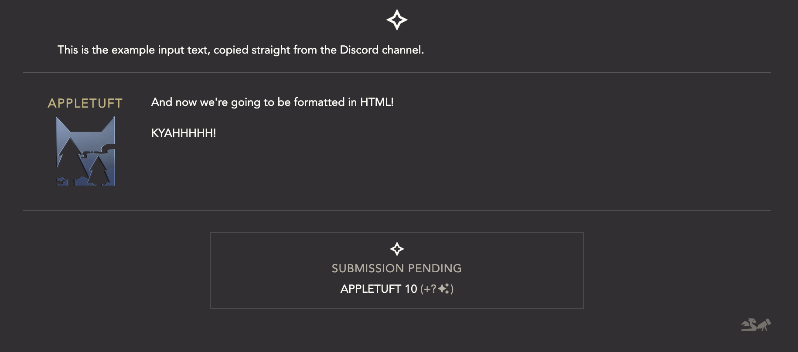

# auto-double-edged-twin
turn copied discord messages into formatted toyhouse literature

## installation

this is a python script. it requires that you have python to be able to run it.

## how to use

1. open terminal or powershell
2. navigate into the `src` folder
3. copy the desired discord conversation and paste it into `src/input.txt`. remove anything from this file that you don't want to be in the final html, like tags, "iw:...", or (edited).
4. execute `python codecode.py`
5. if successful, the terminal will say "all done!" and `src/output.txt` will have the full html contents, ready to paste into a literature chapter

Running the code with the sample input should produce HTML that looks like this.

## Configuration

The `src/customize.py` file is the only code file you need to modify. This section will outline the different areas to modify.

### Your Clan
The code is set up to have different post "sides", with one Clan on the left and the other on the right. Your Clan will be on the left. On line 6, set `YOUR_CLAN` to either `BREEZECLAN` or `MARSHCLAN`.

### Custom Colors
The list of colors is on line 74. This will specify the color of names for player characters and NPCs. 

If you don't want to use custom colors, set line 8 to `USE_CUSTOM_COLORS = False`. You can ignore the colors in the customize file.

### Clan Lists
Starting on line 11 are four lists to divide characters into: BreezeClan player characters, MarshClan player characters, BreezeClan NPCs, and MarshClan NPCs. The list is already mostly populated.

The important thing about names in the list is that they must be lowercase, and that the names must be able to be matched to the Tuppers. If your copied Discord messages includes a message sent by `Rainkit`, it will not be matched to the list's `Rainpaw`. If messages are unexpectedly showing as being part of the narration, make sure the name is correctly on the list.

### Icons
Starting on line 80 are the list of image links to be used for each character. Icons are set already for all player characters, but can be modified in any way you wish. The names of the character must match the same name in the Clan lists.

Any character who does not have a provided link will default to their Clan link.
